# Pat In Key

Pat In Key finds the key and BPM of your DJ tracks, writes them into the files, and gives each file a tidy name.
Drop a folder of music on the window, check the results, and press Apply.

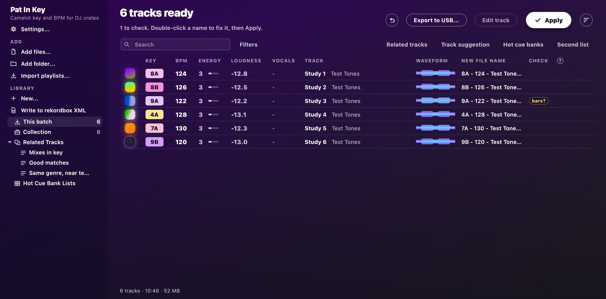

- **Key and BPM:** each track gets a Camelot key (8A) or a musical key (Am), a tempo, and an energy estimate from 1 to 10.
- **Tags and names:** Apply writes the key, BPM, artist and title that rekordbox, Serato, Traktor and Mixxx read, and can rename files to `8A - 124 - Artist - Title.mp3`.
- **Beat grids:** a grid for every track, written for rekordbox, which follows the tempo when a track speeds up or slows down.
- **Cue points:** hot cues A to H, memory cues, loops and cue comments for rekordbox.
- **Waveforms, phrases, loudness and vocals:** a coloured waveform per track, its phrases (Intro, Verse, Build, Drop, Chorus, Groove, Break, Bridge, Outro), its loudness, and a hint of where the vocals are.
- **Track list:** search and filter it, sort it by several columns, choose its columns and row height, and press Space to hear the selected track.
- **Track editor:** hear a track, and set its beat grid, cues and phrases by ear.
- **Automix:** builds a set from your tracks in an order that mixes, lets you hear each transition, plays the set live as one mix, or renders it to one file (new, see below).
- **Library:** playlists, folders, matchlists and favourites, with rating, colour, genre, label, year and My Tag, imported from rekordbox, Apple Music or playlist files if you like.
- **Export to USB:** write a stick that CDJ and XDJ players read, with no rekordbox needed (new, see below).
- **Sync:** send your playlists to Serato, Traktor or Engine DJ (new, see below).
- **Cover art:** tracks with no cover can get one looked up online.
- **Undo:** **Undo last Apply** puts the old names and tags back.

It reads MP3, WAV, AIFF, FLAC, M4A/AAC, Ogg and Opus.
Your music stays on your computer: only artist, title and album are sent, for the cover art lookup, and you can turn that off.

## Download

Get the latest version from the [releases page](https://github.com/plep7/dj-key-tool/releases/latest).

| Computer | Download | Needs |
| --- | --- | --- |
| Mac | [`Pat-In-Key-mac.zip`](https://github.com/plep7/dj-key-tool/releases/latest/download/Pat-In-Key-mac.zip) | Apple silicon (M1 or later), macOS 14.4 or later |
| Windows | [`Pat-In-Key-win64.zip`](https://github.com/plep7/dj-key-tool/releases/latest/download/Pat-In-Key-win64.zip) | 64-bit Windows 10 or 11 |

Nothing else needs installing: the download carries everything the app uses.

### Check the download (optional)

Each zip has a `.sha256` file beside it on the releases page, which proves the download arrived intact.
Put both files in one folder and run this there.

On a Mac, in Terminal:

```bash
shasum -a 256 -c Pat-In-Key-mac.zip.sha256
```

It should print `Pat-In-Key-mac.zip: OK`.

On Windows, in PowerShell:

```powershell
(Get-FileHash -Algorithm SHA256 Pat-In-Key-win64.zip).Hash.ToLower()
Get-Content Pat-In-Key-win64.zip.sha256
```

The two long strings of letters and numbers should match.

## Install on a Mac

1. Double-click `Pat-In-Key-mac.zip` to unzip it.
2. Drag `Pat In Key.app` into your **Applications** folder. Do this before opening it, or the app cannot update itself later.
3. Open it from Applications, as below.

### The first time you open it

The app is not signed by an Apple-registered developer, so macOS stops it the first time.
You only need to do this once.

On macOS 14:

1. Right-click `Pat In Key.app` in Applications and choose **Open**.
2. Choose **Open** again in the message that appears.

On macOS 15 or later, or if the steps above do not offer **Open**:

1. Double-click the app, and choose **Done** when macOS says it was not opened.
2. Open **System Settings > Privacy & Security** and scroll down to **Security**.
3. Next to the line about Pat In Key, choose **Open Anyway**, and confirm with your password or Touch ID.

If macOS still refuses, or says the app is damaged, run this in Terminal and open it again:

```bash
xattr -dr com.apple.quarantine "/Applications/Pat In Key.app"
```

## Install on Windows

1. Right-click `Pat-In-Key-win64.zip`, choose **Extract All**, and pick any folder you can write to, such as Documents. Avoid `Program Files`, where the app cannot update itself.
2. Open the extracted `Pat In Key` folder and double-click `Pat In Key.exe`.

The app is not code-signed, so Windows may say **Windows protected your PC** the first time.
Choose **More info**, then **Run anyway**.
You only need to do this once.

## First use

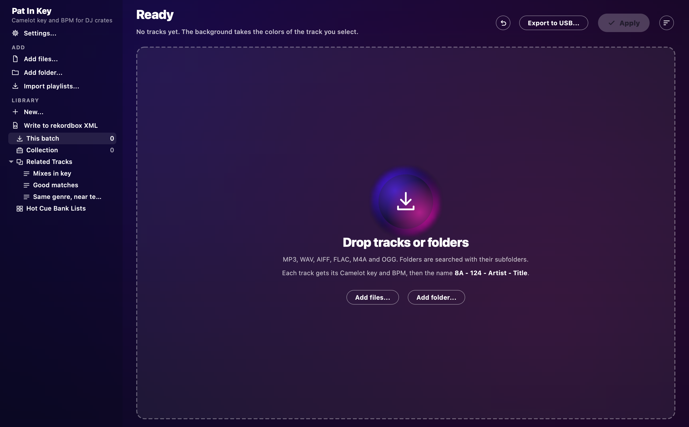

Before your first real run, try it on a copy of 20 or 30 tracks you know well, and keep a backup of your music.

**Renaming and your DJ library:** rekordbox, Serato and Traktor find tracks by file name and folder.
If you rename tracks already in your collection, they show as missing there until you relink them.
Run Pat In Key on new tracks before you import them, and for tracks already in your library, untick **Rename files** in **Settings** and only write tags.

1. **Add tracks.** Drag tracks or whole folders onto the window, or use **Add files** or **Add folder**. Each track is analysed straight away, and results are remembered, so adding the same file again is instant.
2. **Open Settings.** **Settings...** at the top of the sidebar opens them in their own window, as does Cmd+comma on a Mac or Ctrl+comma on Windows. A change takes effect at once.
3. **Pick a key format.** Choose **Camelot (8A)** or **Musical (Am)**.
4. **Choose what Apply does.** **Write tags** and **Rename files** are on to start with. Pick your BPM range too: the first setting suits house and D&B, and **Hip-hop / downtempo** suits slower crates.
5. **Check the table.** A flag in the **Check** column marks a track worth a listen; press the **?** beside that heading for what each flag means. Press Space to hear the selected track, and Space again to pause it. Double-click a title to fix it, or select the track and press Return on a Mac or F2 on Windows. The artist sits beside the title: double-click it to fix it, or where it says *Add artist*.
6. **Press Apply.** A message says what is about to change, and the line under the heading then says what Apply did. **Undo last Apply**, the round arrow beside **Export to USB...**, puts the old names and tags back.

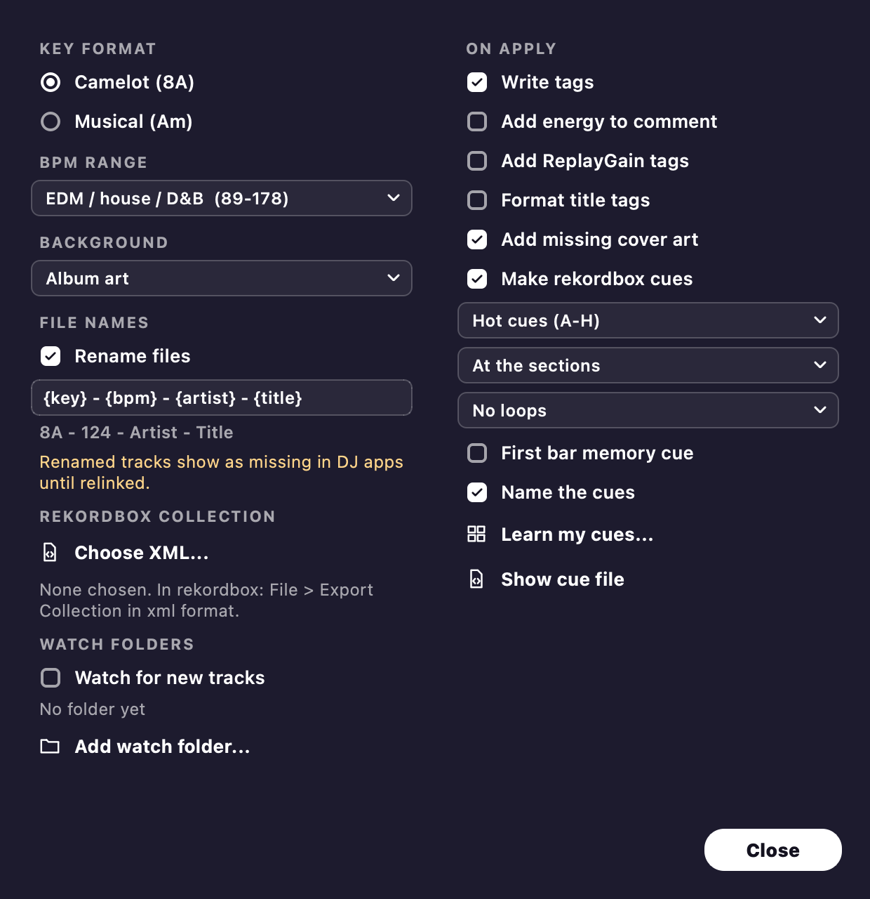

**Background** in **Settings** picks what sits behind the window: **Album art**, the selected track's cover blurred, or a plain **Dark** or **Light** theme.
With Reduce Transparency or Increase Contrast on (Mac), or Transparency effects off or a contrast theme on (Windows), the app uses a solid background, and the contrast settings also make text and edges stronger.

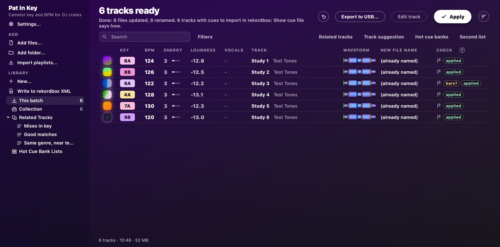

**Finding your way round the table:**

- **Search:** type in the box over the table, or press Cmd+F on a Mac or Ctrl+F on Windows, to show only the tracks that match every word, by title, artist, file name, key, BPM, genre, label or comment. Esc clears it.
- **Filter bar:** press **Filters** beside the search, or Cmd+Shift+F on a Mac or Ctrl+Shift+F on Windows, to narrow the table by BPM, key, rating, colour and My Tag. Half and double time count as the same tempo. **Key** picks from the wheel, and **Compatible** adds the keys that mix with your pick. Filters stay on until **Clear filters**. Apply and the exports then work only on the tracks that show.
- **Command palette:** press Cmd+K on a Mac or Ctrl+K on Windows, type a few letters of any action or playlist, and press Enter. It offers whatever can run right now, including what the right-click menus do for the selected tracks, so `rating 4` rates them. Esc closes it.
- **Columns:** right-click a column heading, or open **View > Columns**, to show or hide a column. Drag a heading to move it, and drag the line between two headings to resize. **Reset columns** puts them back.
- **Rows:** **View > Rows** switches between compact rows, one line each, and comfortable rows, with the artist under the title and the old file name under the new one.
- **Sorting:** click a heading to sort by it, and again to reverse. Shift-click more headings to break ties, such as Key, then BPM, then Track. Keys sort around the circle of fifths, so keys that mix sit together.
- **Jump to a track:** with the table in focus, type the start of a name to jump to it, in the column the table is sorted by. Start a name with a capital E, as plain E opens the editor.
- **Status:** an icon beside the cover says what state a track is in: a clock while it waits, a spinner while it is analysed, a `!` when its file is missing, a padlock when it is locked, a pencil when its grid or cues were edited, and a flag when it has cues. Hover over the heading for what each means.
- **The line under the table** gives the number of tracks showing, their length and their size. Select two or more tracks and it counts those.
- **Harmonic match:** select a track, or play one from the list, and the Key column shows what mixes with it. Matching keys keep their colour and the rest dim, with a bold tick for the same key and a fine tick for a key a step away. **View > Harmonic match** chooses Strict, Fuzzy, which also takes the next key in the other mode, or Off.

After Apply, your DJ app needs to read the tags again.
In rekordbox, select the tracks, right-click and choose **Reload Tags**.
Leave **KEY** unticked in rekordbox's **Preferences > Analysis** and in any Analysis Setting box, or rekordbox replaces the key with its own.

### Cue points for rekordbox

In **Settings**, tick **Make rekordbox cues** and choose **Hot cues** or **Memory cues**.
The **Waveform** column then shows each track's waveform with where each cue will go, and comfortable rows count the cues under it.
Audio files are not changed for this: Apply writes the cues to a file for rekordbox to import.

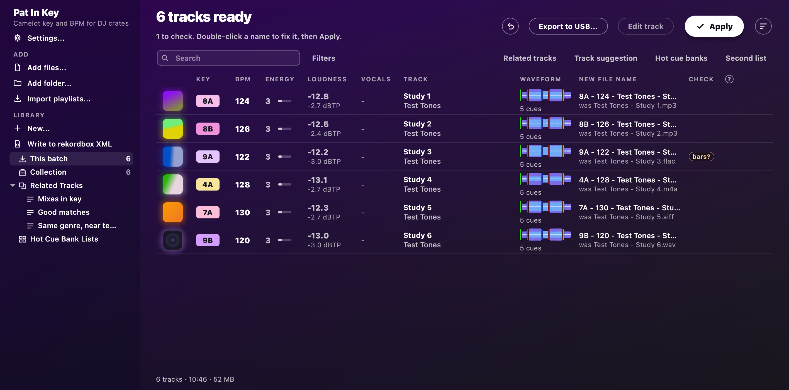

If your tracks are already in rekordbox, export your collection first (**File > Export Collection in xml format**) and pick it with **Choose XML...** in **Settings**.
Pat In Key can then see the cues you set, and leaves those tracks alone.
Without it, importing a track replaces its cues.

To have cues go where you put your own, press **Learn my cues...** under the cue settings and choose tracks you cued yourself, such as your Collection or a playlist.
It needs at least 5 such tracks, and 30 or more in different genres learn your style better.
Then choose **Like my own cues** where the cues go: each track gets the same pads, names and colours, at the same distance from its intro, chorus or other phrases as on your tracks.
**Forget my style**, in the same window, drops what it learnt.

To set up rekordbox once:

1. In **Preferences > Advanced > Database > rekordbox xml**, set **Imported Library** to the cue file. **Show cue file** in the app's **Settings** shows you where it is.
2. In **Preferences > View > Layout**, turn on **rekordbox xml**.

Then after each Apply:

1. Refresh **rekordbox xml** in rekordbox's tree.
2. Open **Playlists > Pat In Key cues** and select its tracks.
3. Right-click and choose **Import To Collection**.
4. If rekordbox says a track already exists, choose **Yes** to give it these cues.

## Your library

Every track you analyse joins your library, which stays between sessions.
The sidebar's **Library** shows **This batch** (what you added since opening the window), **Collection** (everything), and your own folders and playlists.
Apply works on what the table shows, so a batch is how you tag a few new tracks without touching the rest.

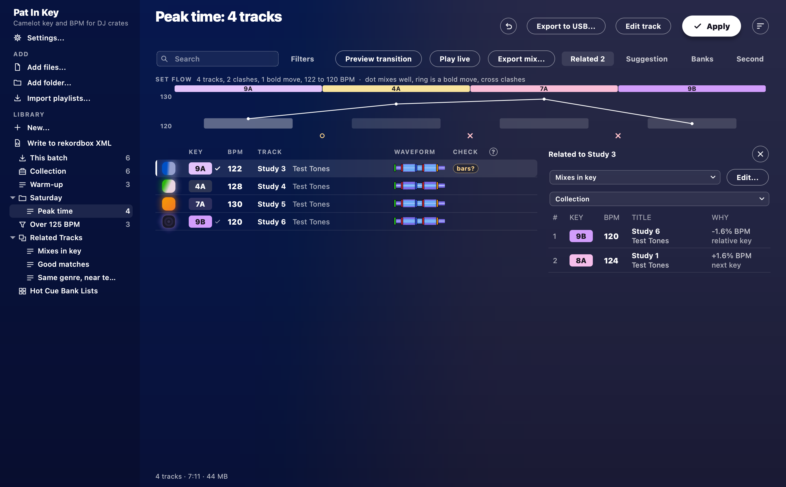

- **Playlists and folders:** press **New...** under **Library** and choose **New playlist** or **New folder**, then drag tracks onto them. Drag folders and playlists to rearrange them.
- **Matchlists:** choose **New matchlist** from **New...** and set its filters, as in a rekordbox Intelligent Playlist, for example BPM above 125 and key 8A. It keeps itself up to date. Under **Match all**, set a filter's link to **or** to group it with the one above, as in five-star tracks that are house or techno. **Key** can be set to *mixes with*, for the keys that mix with one, and **In playlist** picks the tracks of one of your playlists.
- **More from a matchlist:** right-click one and choose **Duplicate as playlist** for a plain playlist of what it holds now, to order and edit by hand. **Library > Generate matchlists...** makes one per genre, artist or label, in a **Generated playlists** folder, and running it again adds only the missing ones.
- **Favourites:** right-click a playlist or matchlist and choose **Add to favourites** to pin it above the library, up to eight. Click one to open it, and drag tracks onto it as you would onto the playlist in the tree. Drag favourites to reorder them, and **Add to playlist** lists them first.
- **Second list:** the **Second list** tab shows another track list beside the table, as rekordbox's Sub Browser does, so you can pick from one list into another. Choose what it shows at its top, or right-click a playlist and choose **Show in the second list**. Drag rows across and they land where you let go, or press Cmd+Return on a Mac or Ctrl+Return on Windows to add the selected tracks to the end of the other list.
- **Track details:** rating, colour, genre, label, year, comment and My Tag, in the table and in what goes to rekordbox.
- **Import:** **Import playlists...** brings in a rekordbox XML (tracks, playlists, cues and grids), an Apple Music library export, or M3U, PLS and TXT playlists.
- **Play history:** **Import playlists...** also takes rekordbox's `HISTORY` playlists from its XML, and what a CDJ or XDJ remembers playing from a rekordbox stick (`PIONEER/rekordbox/export.pdb`). Each set goes into **History**, by date, and counts towards its tracks' plays, in the **Plays** column (show it from **View > Columns**). Importing the same history again does not count it twice.
- **Watch folders and Incoming:** tick **Watch for new tracks** in **Settings**, and any track that lands in your watch folder (`Music/Pat In Key/Watch Folder` to start with, or folders you add) joins your library by itself, is analysed, and waits in **Incoming**. Work through each one and press **Selected done**, or **All done** for the lot. Watching is off until you turn it on.
- **Smart Fixes:** **Smart Fixes...** in the **Tracks** menu, or on the right-click menu, tidies tags: it removes number prefixes, links and stray characters, fixes ALL CAPS and garbled characters such as `&amp;`, pulls the remixer or artist out of a title, puts (Original Mix) in brackets, and merges spellings of a genre or artist. Every change is listed before anything is written, and **Undo last Apply** takes back the latest fix.
- **Related tracks:** the **Related tracks** tab over the right of the table opens a panel beside it, listing what goes with the selected track, such as tracks that mix in key or sit near its tempo. **Hot cue banks** open there too. Press the tab again, or the panel's X, to close it.
- **Track suggestion:** the **Track suggestion** tab lists what to play next by **Collection Radar** (tracks that sound like it), **Era**, **Mood** or **Association** (the same artist, remixer, label or album), as rekordbox does. **Filters...** narrows Collection Radar to a BPM range, a key range, or tracks with or without vocals.
- **Missing files and duplicates:** **Library > Missing files...** finds tracks whose files moved and points them at their new place. **Library > Find duplicates...** groups copies of the same song. Nothing is deleted without asking.
- **Backup:** **Library > Back up library...** saves everything Pat In Key keeps about your library in one zip, and **Library > Restore library...** brings it back.

The round **Activity** button at the top right, past **Apply**, shows what is running behind the window: analysis, Apply, USB exports, duplicate scans and folder searches.
Press it, or Cmd+J on a Mac or Ctrl+J on Windows, to see each job with its progress and a **Cancel** button.
A dot on the button means a finished job has something for you, such as results to open.
Cancel never leaves a file half done.

## Automix

Automix builds a set for you: it picks tracks that mix and puts them in an order where each one leads into the next.

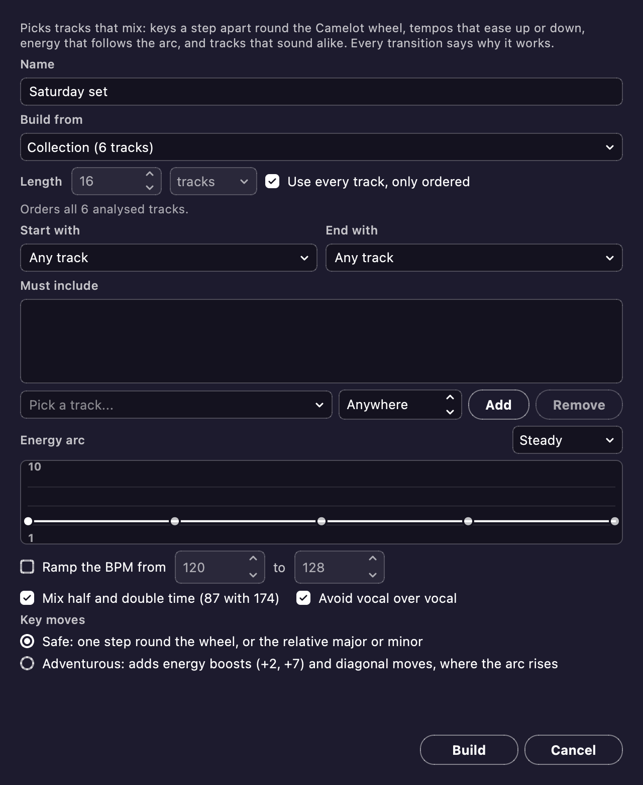

1. Under **Library**, press **New...** and choose **New Automix...**.
   You can also right-click a playlist and choose **New Automix from this...**, or select some tracks, right-click and choose **New Automix from the selected...**.
2. Choose what to build from: your whole collection, a playlist, or the tracks you selected.
3. Set how long the set should be, in tracks or minutes, or tick **Use every track, only ordered** to keep every track and only put them in order.
4. If you like, pick a track to start with, one to end with, tracks it must include, and the shape of the energy through the set.
5. Press **Build**. The set appears as a playlist, ready to reorder, write to rekordbox or export to USB like any other.

It weighs each step on key (round the Camelot wheel), tempo, energy, how alike the tracks sound, and voices: it keeps a vocal from landing on another.
**Safe** keeps to the key moves every DJ knows; **Adventurous** adds energy boosts where the set builds.

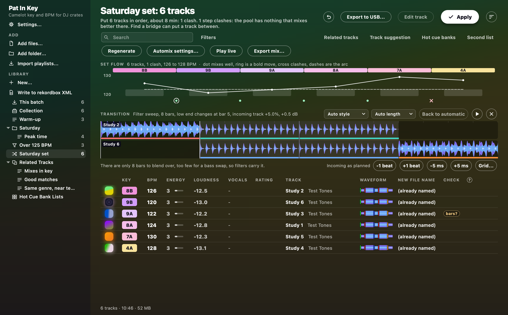

- **Set flow:** the strip over the table shows each track's key, energy and tempo in order. Under each step, a dot mixes well, a ring is a bold move and a cross clashes. Hover over a mark to read why.
- **Find a bridge:** double-click a step's mark to list tracks that could go between those two.
- **Locked in place and Regenerate:** right-click a track and tick **Locked in place** to keep it where it is, then press **Regenerate** for another order around it.
- **Preview transition:** hear any step of the set before you play it out. Each mix starts and ends on the music's phrases, and it picks a style per pair: a bass swap, a filter sweep, an echo-out, a hard cut, a double drop or a loop out. Change the style or length, and nudge the incoming track by a beat or a few milliseconds, if your ears say so. What you set is kept.
- **Play live:** plays the whole set as one continuous mix, from the selected track or the top. Skip mixes into the next track at the next phrase, and you can reorder the playlist while it plays.
- **Export mix...:** renders the whole set to one MP3, FLAC or WAV file, or writes it to rekordbox with a memory cue at each mix in, mix out and bass swap.

**It is new.** Automix plans every mix from the analysis and lines up the kicks by listening to each blend, but few of its mixes have been judged by ear yet.
Listen to a transition before you trust it in front of a crowd, and tell us when one sounds wrong.

## Track editor

Select a track and press E, double-click its waveform or cover, or press **Edit track**, to open the editor.
Return opens it too on Windows, and Cmd+Down on a Mac.
The back arrow or Esc goes back to the table.

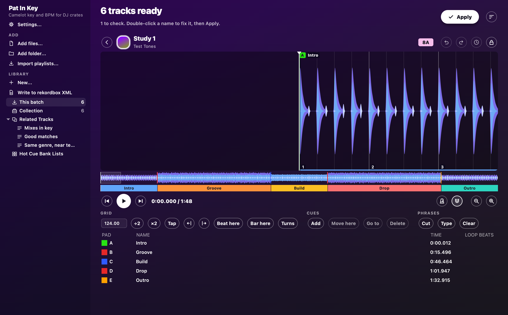

The editor's buttons show icons, as a player's do. Hover over one for its name and key.

- **Play**, the round white button, runs the track, and Space plays or pauses. Click the waveform to move the playhead, and zoom with the magnifier buttons or **+** and **-**. What has already played is dimmed.
- **Click**, the metronome button, adds a metronome, so you can hear whether the grid sits on the beat.
- **BPM**, **÷2**, **×2**, **Tap**, the two arrows (5 ms earlier or later), **Beat here**, **Bar here** and **Turns** fix the grid.
- A pink band along the top of the whole-track strip marks where the tempo drifts, as a warning not to mix there. It is stronger the further the tempo leaves the track's BPM, and hovering over it says the tempos and times.
- Add, move and name cues, and cut, relabel or clear phrases.
- Right-click a cue, in the list or on the waveform, to choose its colour from rekordbox's colours. The colour goes to rekordbox and onto a USB stick.
- Every change is kept at once. **Undo**, **Redo** and **History**, the round arrows and the clock beside the key, take changes back.

While Apply or Undo is writing files, the editor waits for it to finish.

## Export to USB

**Export to USB...** beside **Apply** writes the table's tracks to a stick that CDJ and XDJ players read, with their grids, cues, waveforms and phrases, and no rekordbox involved.
It is made for the XDJ-RX3 and CDJ-3000.

**It is new.** No real player has read a Pat In Key stick yet, so use a spare stick with nothing on it you need.
The [USB stick test kit](USB-TEST-KIT.md) shows how to make a test stick, and has a page to send a friend who tries it on their player.

It keeps your stick safe: you choose the stick yourself, only removable drives are offered, nothing is ever formatted, and a stick that already holds a rekordbox library is refused.
Tracks a player cannot play (Opus, Ogg, WMA) stay off the stick, and the dialog says why.

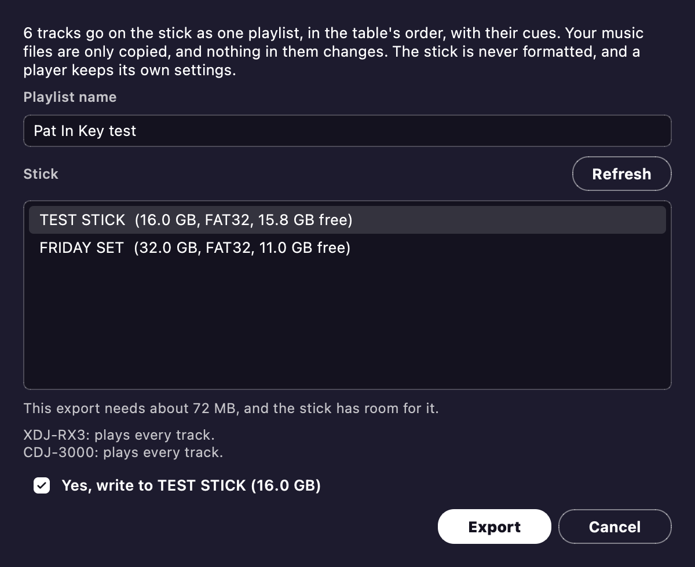

Tick **Put My Settings on the stick** to take your player and mixer setup along, for a player to load, with no rekordbox involved.
**My Settings...** beside the tick sets each one under the name rekordbox gives it, and Pat In Key remembers your choices.
Unticked, the stick carries none, so a player keeps its own setup.
No real player has loaded these settings yet either.

## Sync to Serato, Traktor and Engine

**Sync to Serato, Traktor or Engine...** in the **Tracks** menu sends your playlists to another app's library, so you can prep here and play there.
With no playlists yet, the table's tracks go as one list.

**It is new.** It has been checked against real files from all three apps, but no copy of Serato, Traktor or Engine DJ has opened a synced library yet, so try it on a small playlist first.

| App | What goes | What stays |
| --- | --- | --- |
| Traktor | New tracks with tags, rating, key, BPM, grid and cues, and playlists | Every track already there, with its grid and tags |
| Serato | New tracks and crates, and with the option ticked, cues, written into the music files because that is where Serato keeps them | Your crates, tracks and their grids |
| Engine DJ (2.2 to 5.0) | New tracks with tags, rating, key, grid, cues, loops and an overview waveform, and playlists | Every track already there, with its grid and tags |

- **You see it first.** Picking an app lists every change, and nothing is written until you press **Sync**.
- **Close the app first.** A sync is refused while the other app is open, as all three write their library back when they close.
- **Your lists stay yours.** Everything goes in a folder named Pat In Key, and nothing is taken out of the other app when you delete a playlist here.
- **You can undo it.** Everything the sync can touch is backed up first, and **Undo last sync...** in the dialog puts the app's library back. If the app has changed it since, you are told first, because those changes go too.

## Updating

You do not need to come back here for new versions.
When one is out, the app says so as it opens.

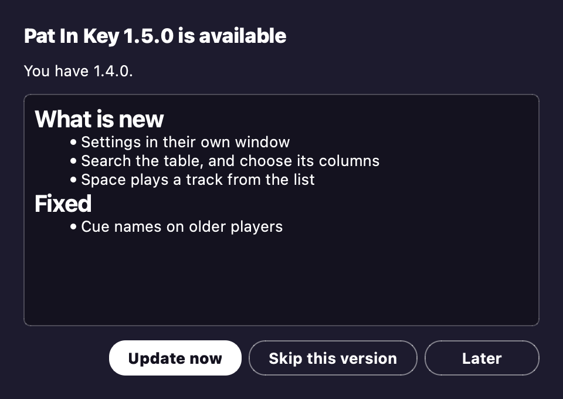

- **Update now** downloads it, checks it, swaps it in and restarts the app.
- **Later** asks again the next time you open the app.
- **Skip this version** stays quiet until a newer one is out.

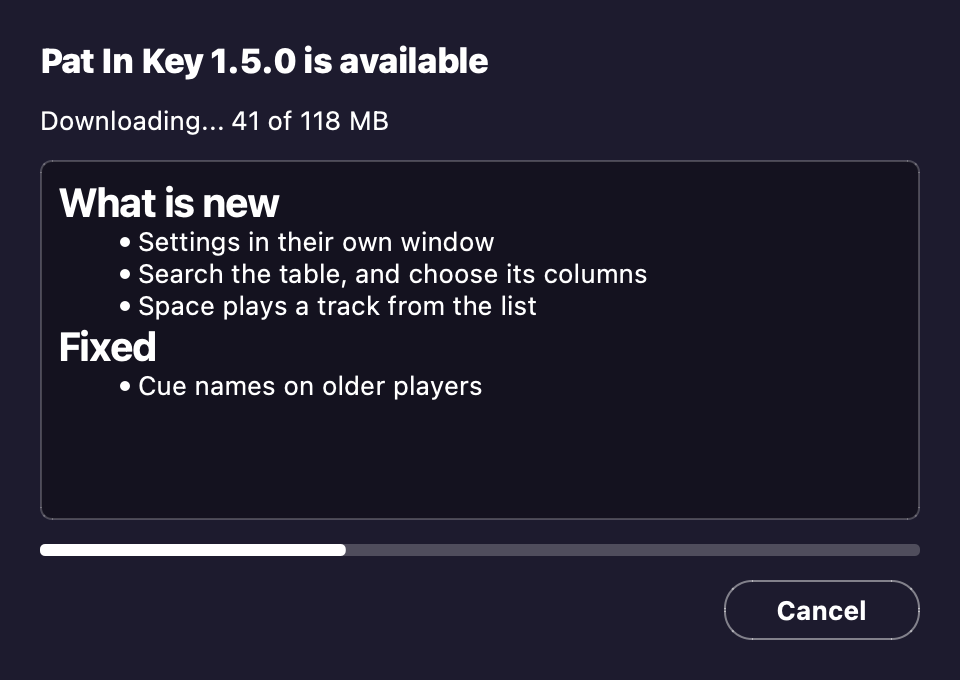

An update waits for a running analysis or Apply to finish.
A restart empties the table, so if it holds tracks you have not applied, the app asks once more first.
Apply first to keep any names you fixed.

After updating to 1.4.0, each track is analysed once more from its audio the first time it shows in the table, when you add it or open a playlist or the Collection that holds it.
This finds bar one, phrases and sections better, which Automix mixes on.
Open **Collection** once to do your whole library in one go.

To look for an update yourself, choose **Check for updates** in the **Pat In Key** menu on a Mac, or the **Help** menu on Windows.
**Check for updates at launch**, in the same menu, turns the automatic look off.
If the app is in a folder it cannot write to, it says so and offers this page instead, so you can download the new version by hand.

## Uninstall

On a Mac, drag `Pat In Key.app` from Applications to the Trash.
On Windows, delete the `Pat In Key` folder.

That leaves your settings, remembered results, cue history and Apply logs behind, in case you come back.
To remove those too, delete this folder:

- Mac: `~/Library/Application Support/Pat In Key`
- Windows: `%APPDATA%\Pat In Key`

Deleting it also removes what **Undo last Apply** needs.
Your music keeps its tags and names.

## Licence

Pat In Key is free software under the GNU AGPL-3.0.
Its licences and source code travel with the app: in the `licenses` and `source` folders on Windows, and inside the app on a Mac, under `Contents/Resources`.

The screenshots show generated test tones, on a Mac.
The Windows window is the same, with its menus above the heading.
