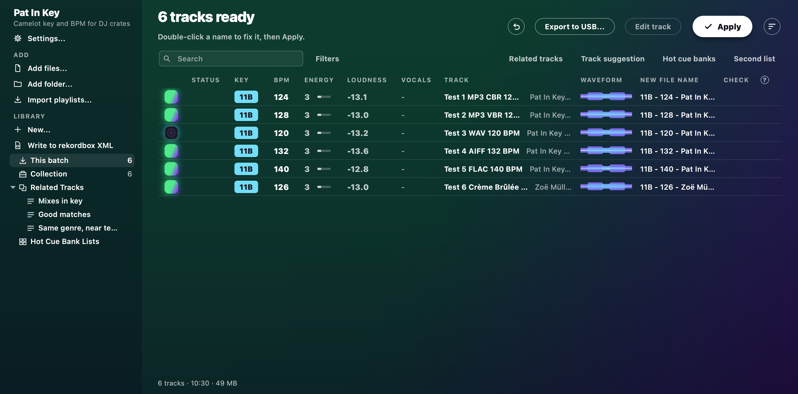
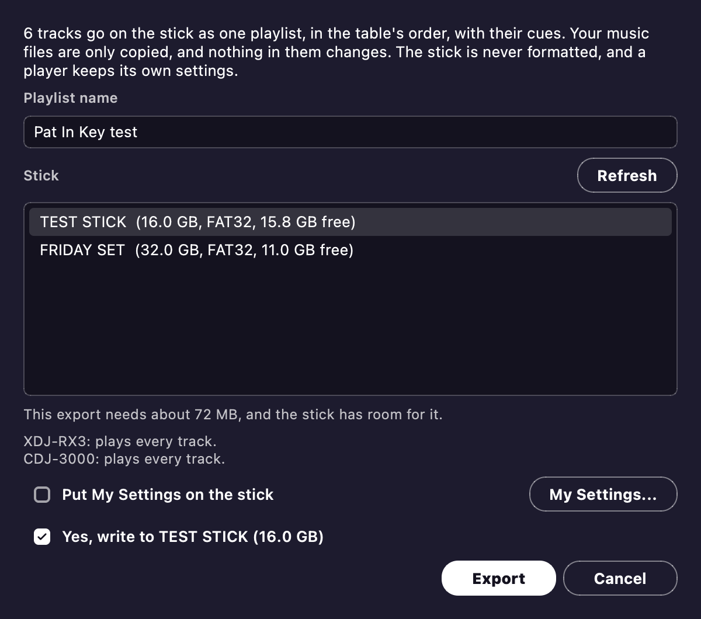
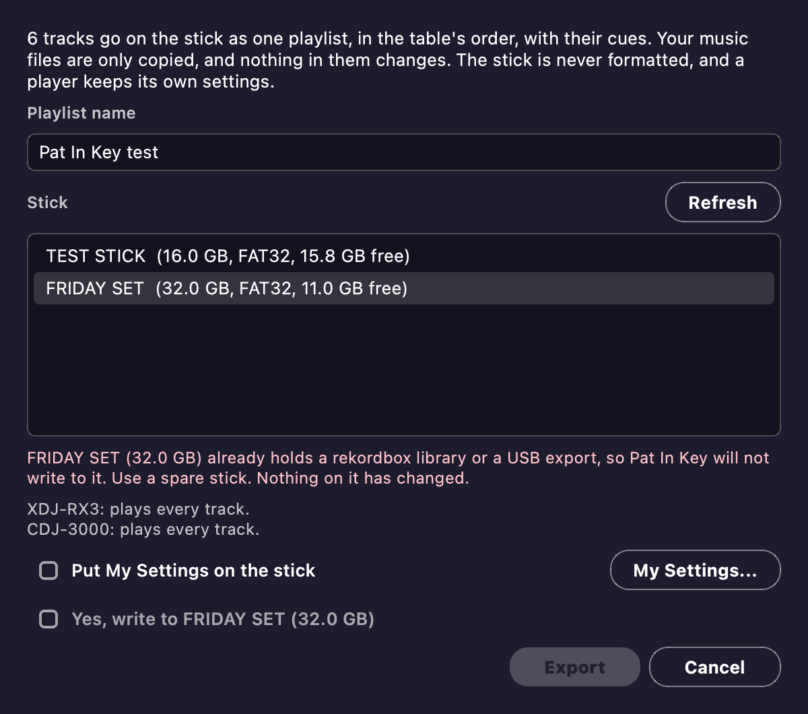

# USB stick test kit

This is how to find out whether real DJ players are happy with a stick made by Pat In Key.
No real player has read one yet, so the first test is the one that counts.

It has two parts.
[For the person making the sticks](#for-the-person-making-the-sticks) comes first.
[The page to send](#the-page-to-send) is what a friend reads, and it can be copied as it is.

## For the person making the sticks

Friends never need Pat In Key.
You make each stick and hand it over.

### What you need

- One spare USB stick per friend, 32 GB or smaller, formatted as FAT32 on a Master Boot Record.
  Both players read that.
  On a Mac, Disk Utility calls it MS-DOS (FAT) with Master Boot Record.
- A build of Pat In Key.
- From source, the export tool, once: `python usb_export.py --fetch-baken`.

Use a spare stick.
Pat In Key refuses a stick with a rekordbox library on it, and it never formats anything, so formatting the stick is up to you.

### Make the six test tracks

```bash
python tests/make_test_tracks.py ~/Desktop/PatInKeyTest
```

This makes six tracks of about two minutes each, so nothing on the stick is copyrighted or personal.
Each one has obvious changes where its cues should land, and its tempo is in its title.

| Track | Format | What it checks |
| --- | --- | --- |
| 1 | MP3, 320 kbps | Baseline, and encoder delay |
| 2 | MP3, variable bit rate | Seek accuracy |
| 3 | WAV | Baseline with no delay |
| 4 | AIFF | Baseline with no delay |
| 5 | FLAC | Seeking without a seek table |
| 6 | M4A (AAC), accented artist and title | Encoder delay, accented names |

All are 44.1 kHz.

### Write the stick

1. Plug the stick in, and open Pat In Key.
2. Drop the `PatInKeyTest` folder on the window and wait for the analysis to finish.

   

3. Press **Export to USB...** beside **Apply**, and type `Pat In Key test` as the playlist name.
4. Click your stick in the list.
   Pat In Key never chooses one for you, even when only one is plugged in.

   

5. Check the name and size, tick **Yes, write to** that stick, and press **Export**.
6. Wait for it to finish, then eject the stick before you pull it out.

If a stick is refused, the dialog says why, and nothing on the stick has changed.



The command line does the same:

```bash
python pat_in_key.py --list-usb
python pat_in_key.py ~/Desktop/PatInKeyTest --export-usb /Volumes/STICK --playlist "Pat In Key test"
```

Do not check a stick by opening it in rekordbox.
rekordbox rewrites a library it opens, which spoils the test.

To see which build a stick came from, read `Pat In Key build.txt` at its root.

### Before you send a stick

Make sure the build has beat grids.
Without them Pat In Key warns that tracks have no beat grid when the export ends, and steps 5 and 10 below cannot work.
`Pat In Key build.txt` should also say `Phrases: 6`, or step 13 has nothing to show.
On each test track the phrases run Intro, Chorus, Up, Chorus, Outro, changing where pads B to E land.

### After a round

A freeze, a blank field or a wrong position is a bug: file it with the photos and the build from `Pat In Key build.txt`, and send a new stick once it is fixed.
A clean result is news for [baken](https://github.com/M-Igashi/baken) too, because nobody has reported an XDJ-RX3 there yet, so it is worth sharing with your friend's OK.

Going back is simple, because nothing permanent happens.
Your friend goes back to their usual stick, and the test stick can be erased.

## The page to send

**Pat In Key stick test (about 15 minutes)**

Thanks for trying this.
This stick was made without rekordbox, and we want to know if your player is happy with it.

**What to install:** nothing.
Everything is already on the stick.

**Before you start**

- Do this at a quiet moment, never during a party.
- Use only this stick for the test.
  Your usual stick is not involved.
- Do not update your player's firmware for this.
- Do not plug this stick into a computer with rekordbox open.
  rekordbox can change it and spoil the test.

**If anything goes wrong**

Take a photo of the screen if you can.
Pull the stick out.
If the player is stuck, turn it off, wait 10 seconds and turn it back on.
Then carry on with your usual stick.
People testing similar sticks have needed nothing more than that.

**What to do**

| Step | Do this | Tell us | Photo |
| --- | --- | --- | --- |
| 1 | Turn the player on and plug in the stick | Any message or error code? If there is one, pull the stick and try once more | Yes, if a message appears |
| 2 | Open the playlist called `Pat In Key test` | Six tracks, in order? | Yes |
| 3 | Load track 1 | Do the title, artist, BPM, key and picture look right? | Yes |
| 4 | Look at the waveform | In colour straight away, or plain first and colour a bit later? | Yes |
| 5 | Press play and jump to the start, middle and end | Do the beat lines sit on the kick drums? | Yes, one of each |
| 6 | Press pads A to E | Does each jump where the music changes? Do you see the names Intro, Drop, Break, Drop 2 and Outro? | Yes, the pad screen |
| 7 | Do steps 3 to 6 on tracks 2 to 6 | Anything different from track 1? Track 3 has no picture, and that is fine | Only if something looks wrong |
| 8 | On track 5, jump around and set a 4-beat loop | Any stutter, skip or wrong place? | No |
| 9 | Search for the accented artist name on track 6 | Is it found? Does the name look right? | Yes |
| 10 | If you have two decks, load two tracks and press BEAT SYNC | Do they stay together for a minute? | No |
| 11 | Open Utility and find `VERSION No.` | Which version? | Yes, plus the player's model name |
| 12 | Look for any vocal or phrase display on the waveform | Is there one? | Yes, if so |
| 13 | On an XDJ-RX3 only: find `WAVEFORM DIVISIONS` in the player's settings, set it to `PHRASE`, and load track 1. Set it back afterwards | Do coloured phrase bands replace the time scale? Do they change where pads A to E jump? | Yes |

**How to report back**

Send your photos to the person who gave you the stick, with a short note saying yes or no for each step.
Say anything that seemed odd, even if you are not sure it matters.
Then keep the stick for the next round, or erase it.
Nothing else on your player needs undoing.
