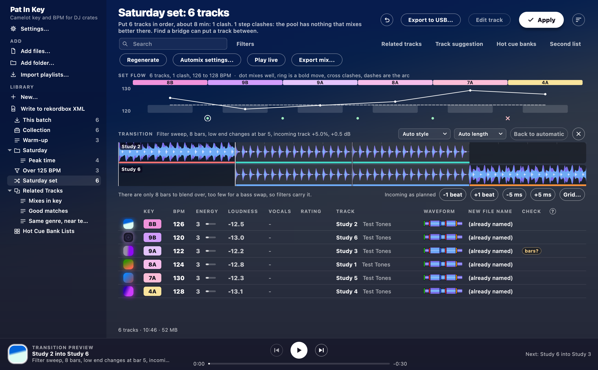
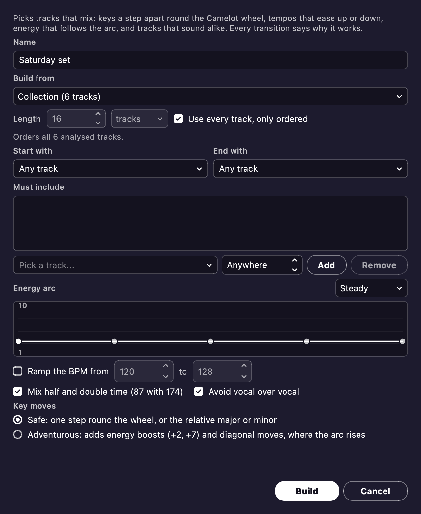

# Automix

Automix builds a set for you.
It picks tracks that mix, and puts them in an order where each one leads into the next.

**It's new.**
Automix plans every mix from the analysis, and lines up the kicks by listening to each blend.
But few of its mixes have been judged by ear yet.
So listen to a transition before you trust it in front of a crowd, and tell us when one sounds wrong.

## Build a set

1. Under **Library**, press **New...** and choose **New Automix...**.
   You can also right-click a playlist and choose **New Automix from this...**.
   Or select some tracks, right-click, and choose **New Automix from the selected...**.
2. Choose what to build from: your whole collection, a playlist, or the tracks you selected.
3. Set how long the set should be, in tracks or minutes.
   Or tick **Use every track, only ordered** to keep every track and just put them in order.
4. If you like, pick a track to start with and one to end with.
   You can also pick tracks it must include, and the shape of the energy through the set.
5. Press **Build**.
   The set appears as a playlist.
   You can reorder it, write it to rekordbox or export it to USB like any other.

Each step gets weighed on key (round the Camelot wheel), tempo, energy and how alike the tracks sound.
Voices count too, so it keeps one vocal from landing on top of another.
**Safe** sticks to the key moves every DJ knows.
**Adventurous** adds energy boosts where the set builds.

## Shape the set

- **Set flow:** the strip over the table shows each track's key, energy and tempo, in order.
  Under each step, a dot mixes well, a ring is a bold move and a cross clashes.
  Hover over a mark to read why.
- **Find a bridge:** double-click a step's mark to list tracks that could go between those two.
- **Locked in place and Regenerate:** right-click a track and tick **Locked in place** to keep it where it is.
  Then press **Regenerate** for another order around it.

## Hear it

- **Preview transition:** hear any step of the set before you play it out.
  Each mix starts and ends on the music's phrases.
  It picks a style for each pair: a bass swap, a filter sweep, an echo-out, a hard cut, a double drop or a loop out.
  With [stems](#stems) on, it has more moves, such as one track's vocal over the other's instrumental.
  You can change the style or the length if your ears say so.
  You can also nudge the incoming track by a beat or a few milliseconds.
  Whatever you set is kept.
- **Play live:** plays the whole set as one continuous mix, from the selected track or from the top.
  **Next** on the player bar mixes into the next track at the next phrase.
  You can reorder the playlist while it plays.
  Once a track's stems are ready, the row over the player bar mutes or solos its **Vocals**, **Drums**, **Bass** and **Rest**.

## Export it

**Export mix...** gives you three ways out:

- Render the whole set to one MP3, FLAC or WAV file.
- Write it to rekordbox, with a memory cue at each mix in, mix out and bass swap.
- Put it straight on a USB stick with the same cues, no rekordbox needed.

## Stems

Stems are a track's vocal, drums, bass and the rest, split apart.
Turn on **Separate stems for Automix** in **Settings** to use them.
The first time, Pat In Key asks before it downloads the model that splits them (84 MB).
The splitting then runs slowly in the background, and shows as **Separate stems** in Activity.

With stems, Automix can:

- **Vocal over:** lay one track's vocal over the other's instrumental.
- **Swap parts:** swap the basslines or the drums halfway through a mix, carry the hats, or bring a melody in under the outgoing track.
- **Keep voices apart:** hold the incoming vocal back until the mix is done, so two voices never meet.
- **Mute and solo live:** in **Play live**, click a stem to mute it, and Shift-click or right-click to solo it.

These moves are new too, and nobody has judged them by ear yet.
Pick another style if your ears say so.

You can also right-click tracks and choose **Export acapella...** or **Export instrumental...** to save either as a file of its own.
Play the two together and you get the original back.
