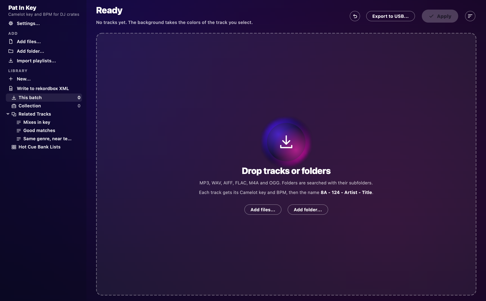
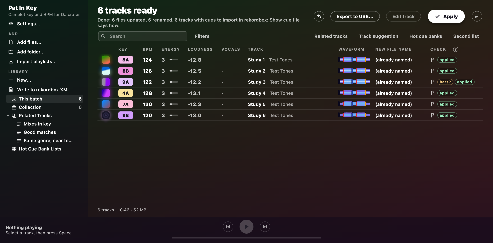
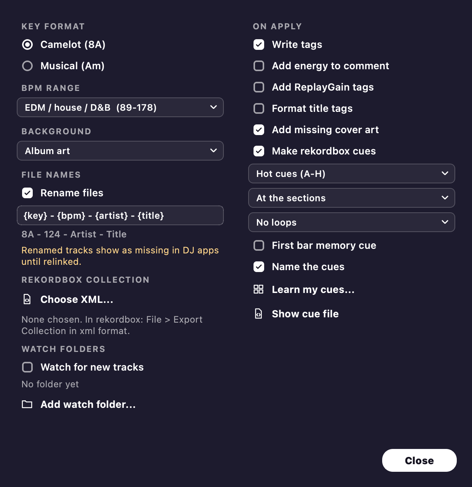

# First steps

This page gets you from an empty window to your first Apply.

## Before your first real run

Try it first on a copy of 20 or 30 tracks you know well.
Keep a backup of your music too.

Watch out with renaming if your tracks are already in a DJ app.
rekordbox, Serato and Traktor find tracks by file name and folder.
So if you rename tracks that are already in your collection, they show up as missing until you relink them.
The easy way round it is to run Pat In Key on new tracks before you import them.
For tracks already in your library, untick **Rename files** in **Settings** and only write tags.

## Your first run

1. **Add tracks.**
   Drag tracks or whole folders onto the window, or use **Add files** or **Add folder**.
   Each track gets analysed straight away.
   Results are remembered, so adding the same file again is instant.
2. **Open Settings.**
   **Settings...** at the top of the sidebar opens them in their own window.
   Cmd+comma on a Mac or Ctrl+comma on Windows does the same.
   A change takes effect at once.
3. **Pick a key format.**
   Choose **Camelot (8A)** or **Musical (Am)**.
4. **Choose what Apply does.**
   **Write tags** and **Rename files** start switched on.
   Pick your BPM range too.
   The first setting suits house and D&B, and **Hip-hop / downtempo** suits slower crates.
5. **Check the table.**
   A flag in the **Check** column marks a track worth a listen.
   Press the **?** beside that heading to see what each flag means.
   Press Space to hear the selected track, and Space again to pause it.
6. **Fix any names.**
   Double-click a title to fix it, or select the track and press Return on a Mac or F2 on Windows.
   The artist sits beside the title.
   Double-click it to fix it, or click where it says *Add artist*.
7. **Press Apply.**
   A message tells you what's about to change.
   Afterwards, the line under the heading says what Apply did.

Changed your mind?
**Undo last Apply** is the round arrow beside **Export to USB...**.
It puts the old names and tags back.

## What each track gets

- A key, a BPM and an energy level from 1 to 10.
- A beat grid for rekordbox, which follows the tempo when a track speeds up or slows down.
- A coloured waveform and its loudness.
- Its phrases: Intro, Verse, Build, Drop, Chorus, Groove, Break, Bridge and Outro.
- A hint of where the vocals are.
- Hot cues A to H, memory cues, loops and cue comments for rekordbox, if you switch cues on ([Cues for rekordbox](rekordbox-cues.md)).
- A cover, looked up online, if the track has none.

## Back in rekordbox

Your DJ app needs to read the tags again after Apply.
In rekordbox, select the tracks, right-click and choose **Reload Tags**.

Leave **KEY** unticked in rekordbox's **Preferences > Analysis**, and in any Analysis Setting box.
Otherwise rekordbox swaps the key for its own.

## Settings worth a look

**Background** picks what sits behind the window.
**Album art** shows the selected track's cover, blurred.
**Dark** and **Light** are plain themes.
On a Mac, Reduce Transparency or Increase Contrast switches the app to a solid background.
On Windows, turning Transparency effects off or using a contrast theme does the same.
The contrast settings also make text and edges stronger.

**Audio output** is where Pat In Key plays.
**Same as system** plays wherever your computer plays.
It even moves over mid-track when you connect AirPods or headphones.
Pick a device instead if you always want to play on it.
While that device isn't connected, the sound plays wherever your computer plays, and Settings tells you so.

## Next

Learn your way round [the track table](track-table.md), or set up [cues for rekordbox](rekordbox-cues.md).
