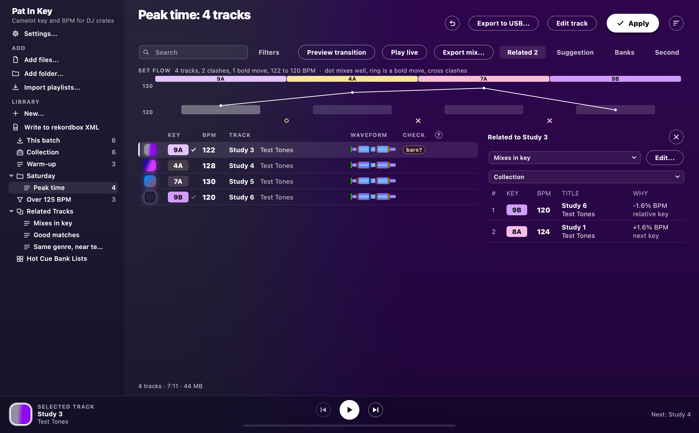

# Your library

Every track you analyse joins your library, and it's still there next time you open the app.

## The basics

The sidebar's **Library** shows three kinds of thing:

- **This batch** holds what you added since you opened the window.
- **Collection** holds everything.
- Your own folders and playlists sit below them.

Apply works on whatever the table shows.
So a batch is how you tag a few new tracks without touching the rest.

## Playlists, matchlists and favourites

- **Playlists and folders:** press **New...** under **Library** and choose **New playlist** or **New folder**.
  Then drag tracks onto them.
  Drag folders and playlists around to rearrange them.
- **Matchlists:** choose **New matchlist** from **New...** and set its filters, like a rekordbox Intelligent Playlist.
  For example, you could ask for BPM above 125 and key 8A.
  A matchlist keeps itself up to date.
  Under **Match all**, set a filter's link to **or** to group it with the one above.
  That gets you five-star tracks that are house or techno, say.
  **Key** can be set to *mixes with*, for the keys that mix with one.
  **In playlist** picks the tracks of one of your playlists.
- **More from a matchlist:** right-click one and choose **Duplicate as playlist**.
  You get a plain playlist of what it holds right now, to order and edit by hand.
  **Library > Generate matchlists...** makes one per genre, artist or label, in a **Generated playlists** folder.
  Running it again adds only the missing ones.
- **Favourites:** right-click a playlist or matchlist and choose **Add to favourites**.
  It gets pinned above the library, and you can pin up to eight.
  Click a favourite to open it, or drag tracks onto it as you would onto the playlist in the tree.
  Drag favourites to reorder them.
  **Add to playlist** lists them first.
- **Second list:** the **Second list** tab shows another track list beside the table, like rekordbox's Sub Browser.
  It's handy for picking from one list into another.
  Choose what it shows at its top, or right-click a playlist and choose **Show in the second list**.
  Drag rows across and they land where you let go.
  Or press Cmd+Return on a Mac or Ctrl+Return on Windows to add the selected tracks to the end of the other list.

## Track details

Each track has a rating, colour, genre, label, year, comment and My Tag.
They show in the table and go to rekordbox.

## Getting tracks in

- **Import:** **Import playlists...** brings in a rekordbox XML, with its tracks, playlists, cues and grids.
  It also takes an Apple Music library export, and M3U, PLS and TXT playlists.
- **Play history:** **Import playlists...** also takes rekordbox's `HISTORY` playlists from its XML.
  It reads what a CDJ or XDJ remembers playing from a rekordbox stick too (`PIONEER/rekordbox/export.pdb`).
  Each set goes into **History**, by date, and counts towards its tracks' plays.
  You'll see them in the **Plays** column, which you can show from **View > Columns**.
  A matchlist can filter on them too, as **DJ Play Count**.
  Importing the same history again doesn't count it twice.
- **Watch folders and Incoming:** tick **Watch for new tracks** in **Settings**.
  Any track that lands in your watch folder then joins your library by itself, gets analysed, and waits in **Incoming**.
  The watch folder starts as `Music/Pat In Key/Watch Folder`, and you can add more folders.
  Work through each track and press **Selected done**, or press **All done** for the lot.
  Watching stays off until you turn it on.

## Tidying up

- **Smart Fixes:** find **Smart Fixes...** in the **Tracks** menu, or on the right-click menu.
  It tidies tags.
  It removes number prefixes, links and stray characters.
  It fixes ALL CAPS and garbled characters such as `&amp;`.
  It pulls the remixer or artist out of a title, and puts (Original Mix) in brackets.
  It also merges different spellings of a genre or artist.
  Every change gets listed before anything is written, and **Undo last Apply** takes back the latest fix.
- **Missing files:** **Library > Missing files...** finds tracks whose files moved, and points them at their new place.
- **Duplicates:** **Library > Find duplicates...** groups copies of the same song.
  Nothing gets deleted without asking you.
- **Backup:** **Library > Back up library...** saves everything Pat In Key keeps about your library in one zip.
  **Library > Restore library...** brings it back.

## What to play next

- **Related tracks:** the **Related tracks** tab, over the right of the table, opens a panel beside it.
  It lists what goes with the selected track, such as tracks that mix in key or sit near its tempo.
  It can also go by a shared My Tag, the same remixer or comment, or tracks played near it in your sets.
  **Hot cue banks** open there too.
  Press the tab again, or the panel's X, to close it.
- **Track suggestion:** the **Track suggestion** tab lists what to play next, as rekordbox does.
  **Collection Radar** finds tracks that sound like it.
  You can also go by **Era**, **Mood** or **Association**, which means the same artist, remixer, label or album.
  **Filters...** narrows Collection Radar to a BPM range, a key range, or tracks with or without vocals.
  **Mashup** finds tracks whose acapella fits over this one's instrumental, or the other way round.
  It's a lead to listen to, not a promise.

## Activity

The round **Activity** button sits at the top right, past **Apply**.
It shows what's running behind the window: analysis, Apply, USB exports, duplicate scans and folder searches.
Press it, or Cmd+J on a Mac or Ctrl+J on Windows, to see each job with its progress and a **Cancel** button.
A dot on the button means a finished job has something for you, such as results to open.
Cancel never leaves a file half done.

## Next

Build a set from your library with [Automix](automix.md).
