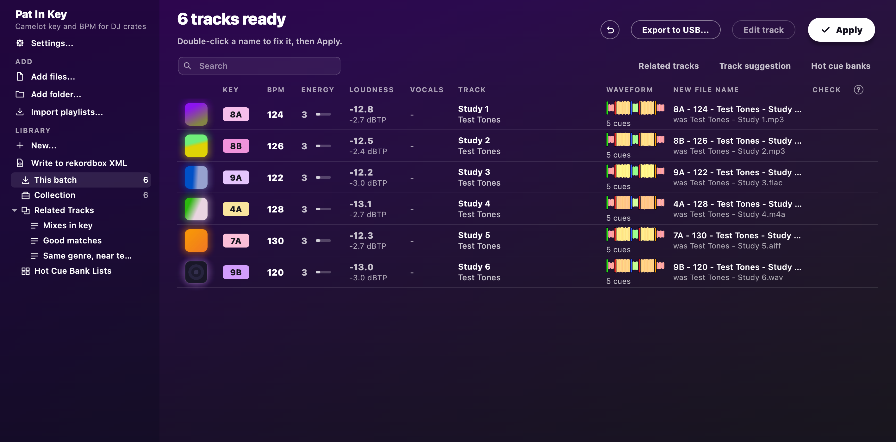

# Cues for rekordbox

Pat In Key can place hot cues or memory cues on every track, ready for rekordbox to import.

## Switch cues on

In **Settings**, tick **Make rekordbox cues** and choose **Hot cues** or **Memory cues**.
The **Waveform** column then shows each track's waveform, with where each cue will go.
Comfortable rows count the cues under it.

Your audio files aren't changed for this.
Apply writes the cues to a separate file, and rekordbox imports them from there.

## Keep the cues you already set

Are your tracks already in rekordbox?
Then export your collection first, with **File > Export Collection in xml format** in rekordbox.
Pick that file with **Choose XML...** in Pat In Key's **Settings**.
Pat In Key can then see the cues you set, and it leaves those tracks alone.
Without it, importing a track replaces its cues.

## Cues in your own style

You can have cues land where you'd put them yourself.
Press **Learn my cues...** under the cue settings, and choose tracks you cued yourself, such as your Collection or a playlist.
It needs at least 5 of those tracks.
30 or more, across different genres, teach it your style better.

Then choose **Like my own cues** for where the cues go.
Each track gets the same pads, names and colours as your tracks.
They sit at the same distance from its intro, chorus or other phrases as on your tracks.
**Forget my style**, in the same window, drops what it learnt.

## Set up rekordbox once

1. In **Preferences > Advanced > Database > rekordbox xml**, set **Imported Library** to the cue file.
   **Show cue file** in Pat In Key's **Settings** shows you where it is.
2. In **Preferences > View > Layout**, turn on **rekordbox xml**.

## After each Apply

1. Refresh **rekordbox xml** in rekordbox's tree.
2. Open **Playlists > Pat In Key cues** and select its tracks.
3. Right-click and choose **Import To Collection**.
4. If rekordbox says a track already exists, choose **Yes** to give it these cues.

## Next

Want to move a cue by ear?
The [track editor](track-editor.md) lets you.
