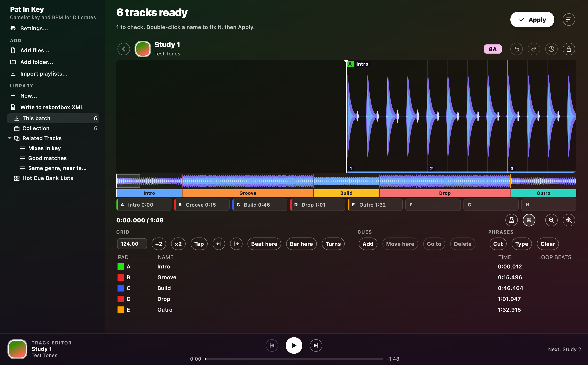

# Track editor

The editor is where you check a track by ear, and fix its beat grid, cues and phrases.

## Open and close it

Select a track and press E, or press **Edit track**.
Double-clicking its waveform or cover works too.
On Windows Return opens it, and on a Mac Cmd+Down does.
The back arrow or Esc takes you back to the table.

The editor's buttons show icons, like a player's.
Hover over one to see its name and key.

## Listen

- **Play** is the round white button in the player bar at the bottom of the window.
  Space plays or pauses.
- **Previous** and **Next** beside it open the track above or below.
- Click the waveform to move the playhead.
- Zoom with the magnifier buttons, or with **+** and **-**.
- What has already played is dimmed.
- **Click**, the metronome button, adds a metronome, so you can hear whether the grid sits on the beat.

## Fix the grid

**BPM**, **÷2**, **×2**, **Tap**, **Beat here**, **Bar here** and **Turns** fix the grid.
The two arrows move it 5 ms earlier or later.
Beat lines you moved turn mint, so you can tell them from the ones the analysis placed.

A pink band along the top of the whole-track strip marks where the tempo drifts.
Take it as a warning not to mix there.
It gets stronger the further the tempo strays from the track's BPM.
Hover over it to see the tempos and times.

## Cues and phrases

- Add, move and name cues.
- Cut, relabel or clear phrases.
- The eight pads A to H under the waveform hold the hot cues.
  Click a pad, or press **1** to **8**, to jump to its cue.
  On an empty pad, that sets a cue instead.
  Hold Shift to set the pad's cue where the playhead is.
- Right-click a cue, in the list or on the waveform, to pick its colour from rekordbox's colours.
  The colour goes to rekordbox and onto a USB stick.
- A yellow line along the foot of the waveform shows where there's a voice.
  It's a hint, not a promise.

## Undo

Every change gets kept straight away.
**Undo**, **Redo** and **History** take changes back.
They're the round arrows and the clock beside the key.

While Apply or Undo is writing files, the editor waits for it to finish.
