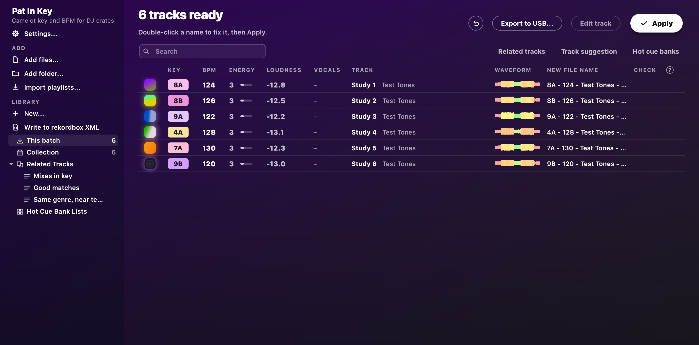

# The track table

The table is where your tracks live, with their key, BPM, energy and checks.
Here's how to get around it fast.

## Finding tracks

- **Search:** type in the box over the table, or press Cmd+F on a Mac or Ctrl+F on Windows.
  The table then shows only the tracks that match every word.
  It searches title, artist, file name, key, BPM, genre, label and comment.
  Esc clears it.
- **Filter bar:** press **Filters** beside the search, or Cmd+Shift+F on a Mac or Ctrl+Shift+F on Windows.
  It narrows the table by BPM, key, rating, colour and My Tag.
  Half time and double time count as the same tempo.
  **Key** picks from the wheel, and **Compatible** adds the keys that mix with your pick.
  Filters stay on until you press **Clear filters**.
  While they're on, Apply and the exports work only on the tracks that show.
- **Jump to a track:** with the table in focus, type the start of a name to jump to it.
  It looks in the column the table is sorted by.
  Plain E opens the editor, so type a capital E for a name that starts with E.
- **Command palette:** press Cmd+K on a Mac or Ctrl+K on Windows, type a few letters of any action or playlist, and press Enter.
  It offers whatever can run right now, including what the right-click menus do for the selected tracks.
  So typing `rating 4` rates them.
  Esc closes it.

## Columns, rows and sorting

- **Columns:** right-click a column heading, or open **View > Columns**, to show or hide a column.
  Drag a heading to move it, and drag the line between two headings to resize.
  **Reset columns** puts them all back.
- **Rows:** **View > Rows** switches between compact and comfortable rows.
  Compact rows take one line each.
  Comfortable rows put the artist under the title, and the old file name under the new one.
- **Sorting:** click a heading to sort by it, and click again to reverse.
  Shift-click more headings to break ties, such as Key, then BPM, then Track.
  Keys sort around the circle of fifths, so keys that mix sit together.

## Reading the table

- **Status:** an icon beside the cover tells you what state a track is in.
  A clock means it's waiting, and a spinner means it's being analysed.
  A `!` means its file is missing, and a padlock means it's locked.
  A pencil means its grid or cues were edited, and a flag means it has cues.
  Hover over the heading to see what each one means.
- **The line under the table** gives the number of tracks showing, their length and their size.
  Select two or more tracks and it counts just those.
- **Harmonic match:** select a track, or play one from the list, and the Key column shows what mixes with it.
  Matching keys keep their colour and the rest dim.
  A bold tick marks the same key, and a fine tick marks a key one step away.
  **View > Harmonic match** chooses Strict, Fuzzy or Off.
  Fuzzy also takes the next key in the other mode.

## Playing tracks

One player sits along the bottom of the window, as in any media player.
It plays whatever's playing: a track, the track editor, a transition or the live set.
Space plays and pauses the selected track, and your keyboard's media keys work it too.

## Next

See where your tracks get kept in [Your library](library.md).
