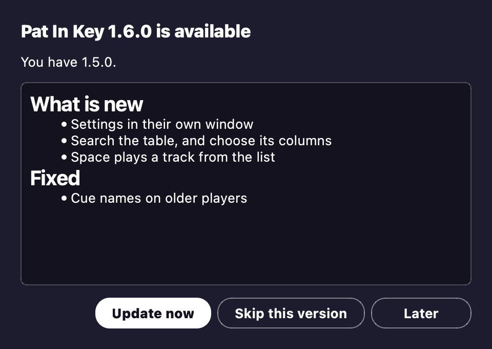
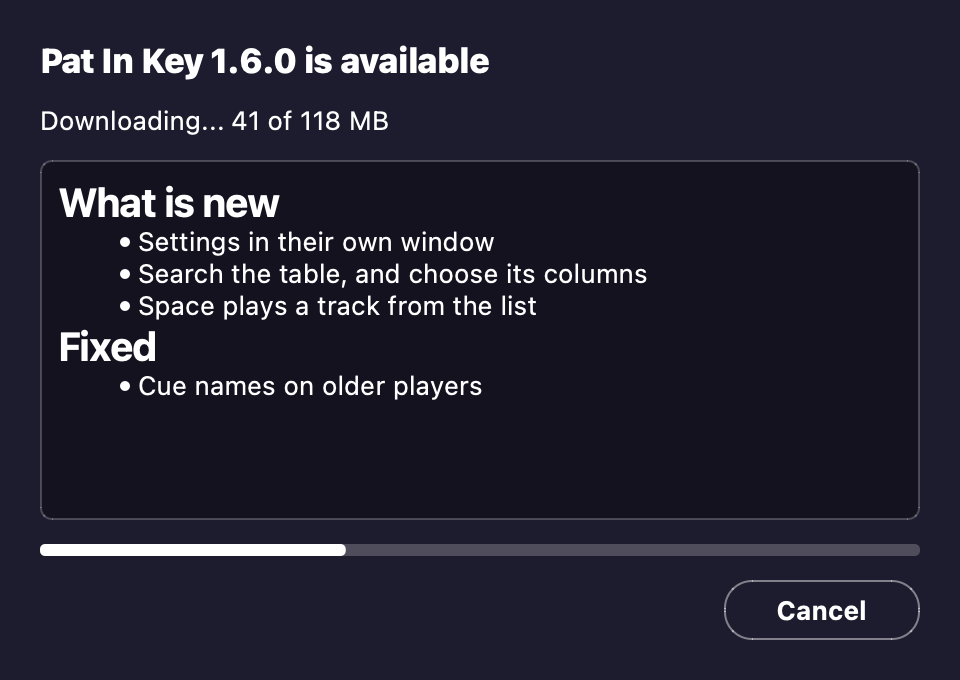

# Updating and uninstalling

You don't need to come back here for new versions.
When one is out, the app tells you as it opens.

## Your three choices

- **Update now** downloads it, checks it, swaps it in and restarts the app.
- **Later** asks again the next time you open the app.
- **Skip this version** stays quiet until a newer one is out.

## Before it restarts

An update waits for a running analysis or Apply to finish.
A restart empties the table.
So if the table holds tracks you haven't applied, the app asks once more first.
Apply first to keep any names you fixed.

## Checking yourself

To look for an update whenever you like, choose **Check for updates**.
It's in the **Pat In Key** menu on a Mac, and the **Help** menu on Windows.
**Check for updates at launch**, in the same menu, turns the automatic check off.

If the app sits in a folder it can't write to, it says so.
It offers you the download page instead, so you can grab the new version by hand.

## After updating to 1.5.0

After updating to 1.5.0, each track gets analysed once more from its audio.
That happens the first time the track shows in the table: when you add it, or open a playlist or the Collection that holds it.
It reads each key at the track's own tuning, and gets the grid and phrases right on more tracks.
Open **Collection** once to do your whole library in one go.
Grids, cues and phrases on tracks you locked in the editor stay as you set them.

## Uninstalling

On a Mac, drag `Pat In Key.app` from Applications to the Trash.
On Windows, delete the `Pat In Key` folder.

That leaves your settings, remembered results, cue history and Apply logs behind, in case you come back.
To remove those too, delete this folder:

- Mac: `~/Library/Application Support/Pat In Key`
- Windows: `%APPDATA%\Pat In Key`

Deleting it also removes what **Undo last Apply** needs.
Your music keeps its tags and names either way.
