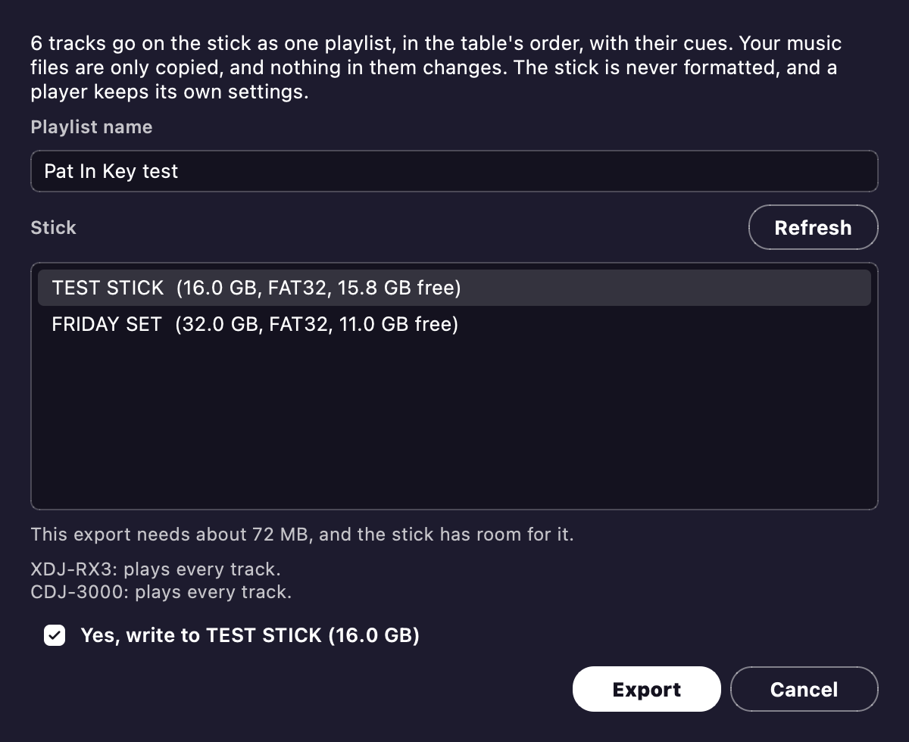

# USB sticks

**Export to USB...** writes your tracks to a stick that CDJ and XDJ players read, with no rekordbox involved.
It's made for the XDJ-RX3 and CDJ-3000.

**It's new.**
No real player has read a Pat In Key stick yet.
So use a spare stick with nothing on it you need.
The [USB stick test kit](usb-test-kit.md) shows how to make a test stick.
It also has a page to send a friend who tries it on their player.

## What goes on the stick

The button sits beside **Apply**.
It writes the table's tracks, with their grids, cues, waveforms and phrases.
Tracks a player can't play (Opus, Ogg, WMA) stay off the stick, and the dialog tells you why.

## Your stick is safe

- You choose the stick yourself.
- Only removable drives are offered.
- Nothing is ever formatted.
- A stick that already holds a rekordbox library is refused.

## My Settings

Tick **Put My Settings on the stick** to take your player and mixer setup along.
A player can then load it, with no rekordbox involved.
**My Settings...** beside the tick sets each one, under the name rekordbox gives it.
Pat In Key remembers your choices.
Leave it unticked and the stick carries none, so a player keeps its own setup.
No real player has loaded these settings yet either.
